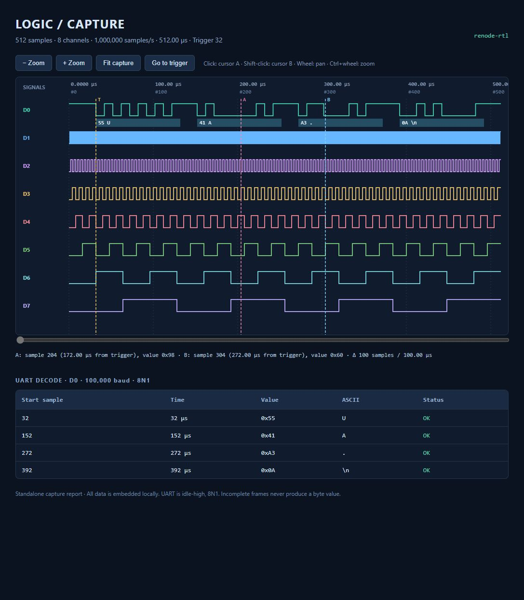
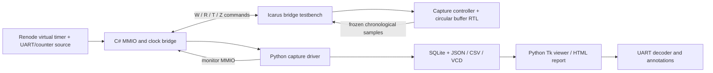

# FPGA logic analyzer

An eight-channel logic analyzer built from SystemVerilog capture/controller and
buffer logic, a Renode virtual board, a transactional Python capture logger,
and a Python/Tk waveform viewer. The Renode board drives the **actual RTL** in
Icarus Verilog through a small synchronous subprocess bridge. The C# peripheral
contains the stimulus generator and transport; it does not duplicate capture
or trigger logic.



## Run it

Clone the source:

```sh
git clone https://github.com/RohitPatel97/fpga-logic-analyzer.git
cd fpga-logic-analyzer
```

In this workspace, the tools are already available. From this project folder:

```powershell
.\run.ps1          # Compile, test, capture, log, decode, and export
.\run.ps1 -View    # Same pipeline, then open the Python desktop viewer
.\run.ps1 -Verify  # Python tests, randomized RTL checks, Renode tests, full demo
```

`run.ps1` locates a local Python installation, including the bundled desktop
runtime. Use `-Python C:\path\to\python.exe` to choose one explicitly.
The viewer has no pip dependencies. Python 3.10+ is required; the desktop viewer
also needs Tkinter. Headless HTML export does not need Tkinter.

For a fresh Windows checkout, install Python with Tkinter, then obtain the
project-local simulator tools without an administrator install:

```powershell
.\scripts\bootstrap_windows.ps1 -Renode
.\run.ps1 -Verify
```

The bootstrap script downloads checksum-pinned native Icarus 13.0 packages
from MSYS2 and optionally Renode 1.17.0 from its official release. It writes
only into `build/tools/`. Existing installations can be selected with
`IVERILOG`, `VVP`, and `RENODE` environment variables, each naming its executable.
The workspace launcher can reuse the neighboring sensor project's Renode
installation; a standalone checkout can use the bootstrap instead.

On Linux, install `iverilog`, Python/Tk (`python3-tk` on Debian/Ubuntu), and
[Renode 1.17.0](https://github.com/renode/renode/releases/tag/v1.17.0), then run:

```sh
python3 scripts/verify.py --renode
python3 scripts/run_demo.py --view
```

The recorded local validation was performed on Windows. The Linux workflow
runs Python/RTL checks and the virtual-board demo; see
[GitHub Actions](https://github.com/RohitPatel97/fpga-logic-analyzer/actions)
for its current hosted results.

## What the demo proves

The demo first runs the self-checking SystemVerilog testbench. It then starts
Renode, arms the RTL through MMIO, advances virtual time, and reads the frozen
buffer through the same register interface. Every one of the 512 captured
samples is compared with an independently constructed waveform **before** UART
decoding is performed.

The virtual board generates a 1 MHz sampling clock. D0 carries 100 kbaud 8N1
UART (`55 41 A3 0A`); D1–D7 expose a binary counter. A falling edge on D0 triggers
at sample 32. The logger round-trips the capture through SQLite and verifies
exact equality. Finally, the UART decoder checks all four bytes and writes the
interactive waveform report.

Outputs are stored under `captures/demo/`:

| File | Purpose |
| --- | --- |
| `capture.json` | Versioned portable capture, raw bytes, metadata, trigger |
| `captures.sqlite3` | Append-only capture records and UART decode records |
| `capture.csv` | Samples, absolute/trigger-relative time, per-channel bits |
| `capture.vcd` | Transition-based waveform for GTKWave or another VCD viewer |
| `waveforms.html` | Self-contained interactive report; open locally in a browser |
| `validation.json` | Assertions that passed, capture ID, and tool paths |
| `rtl-tests.log` | Self-checking testbench output |
| `renode/renode.log` | Full Renode monitor transcript |
| `renode/start.resc` | Generated startup script with tool/model paths |

Each run appends a new capture ID to SQLite. Other demo files are regenerated.
`examples/renode-uart.json` is a saved capture from the verified virtual board.

## Architecture



This is a monitor-controlled virtual FPGA board with a mapped peripheral at
`0x40000000`; no MCU firmware is needed. Renode owns virtual time. Each source
timer event sends one raw sampling tick into Icarus. Register transactions
hold `sample_tick=0` and do not create extra samples. This project uses its own
small lockstep Icarus bridge, not Renode's Verilator integration library.

The first source value (counter zero) arrives at virtual time 1 µs. Capture
timestamps start at the first **retained** sample, and the trigger index marks
its position in that sequence. Renode may continue generating stimuli to the
end of a bounded run chunk after the buffer freezes; those extra ticks do not
change captured data. Virtual 1 MHz specifies waveform timing, not host
throughput or real-time execution speed.

## Capture hardware

- Eight synchronous channels and 1,024 sample words of eight bits each.
- Capture lengths from 1 to 1,024; pretrigger history from 0 to length minus 1.
- Circular history with chronological readout after completion.
- Immediate, masked-level, rising-edge, falling-edge, and software triggers.
- A programmable divider; the first retained sample is on the DIV-th tick.
- Early triggers preserve the available history and extend posttrigger data.
- Abort freezes available data; missing triggers are never invented.
- Active configuration is protected; invalid configurations set an error flag.

See [the complete register and sampling contract](sim/README.md), including
control priority, mask semantics, abort behavior, and bridge commands.

## Python tools

Install the command line entry point into your own virtual environment:

```sh
python -m venv .venv
# Activate .venv, then:
python -m pip install -e .
logic-analyzer view captures/demo/capture.json --baud 100000 --channel 0
logic-analyzer decode captures/demo/capture.json --baud 100000
logic-analyzer report captures/demo/capture.json --output waveforms.html
logic-analyzer report captures/demo/capture.json --no-uart --output digital.html
logic-analyzer export captures/demo/capture.json --format vcd --output capture.vcd
logic-analyzer log captures/demo/capture.json --db captures/lab.sqlite3 --label experiment
logic-analyzer list --db captures/lab.sqlite3
logic-analyzer restore 1 --db captures/lab.sqlite3 --output restored.json
```

`python -m logic_analyzer` accepts the same commands. Without installation,
set `PYTHONPATH` to the project's `src` directory. The launcher and scripts do
this automatically where needed.

The Tk viewer offers zoom, pan, trigger centering, two cursors, sample values,
timing deltas, selectable UART frames, and HTML export. The HTML report embeds
all data locally and works without a server or network connection. At wide
zoom levels the viewer uses per-pixel signal envelopes to retain narrow pulses;
zoom in to inspect individual edges and samples.

The decoder detects idle-high start edges and samples bit centers with
fractional timing. The Python `decode_uart` API supports 5–9 data bits, optional
even/odd parity, and 1, 1.5, or 2 stop bits; the viewer's controls use 8N1. It
reports framing, parity, and truncation errors. Incomplete frames have no byte
value. Use a sample rate of at least four samples per UART bit. A capture
starting inside a frame cannot establish that frame's missing start edge.

The logger uses SQLite transactions, a SHA-256 checksum over little-endian
32-bit packed sample words, and UTC creation timestamps. Capture JSON has
schema version 1 and supports 1–32 channels with at most one million samples;
this FPGA produces eight-channel captures of at most 1,024 samples. JSON writes
are atomic. VCD timestamps are rounded to picoseconds.

For custom capture configuration, run from the project root and import the driver:

```python
from pathlib import Path
import sys
sys.path.insert(0, "scripts")
from renode_capture import capture

data = capture(
    Path("path/to/renode"), Path("path/to/vvp"), Path("build/bridge.vvp"),
    Path("captures/custom/renode"),
    length=256, pretrigger=16, divider=2, trigger_mode=3, mask=1,
)
# data['sample_rate_hz'] is 500000; sample timestamps reflect this divider.
```

## Verification

```sh
python scripts/verify.py             # Python + self-checking RTL + randomized scoreboard
python scripts/verify.py --renode    # Also exercise real Renode success/failure/reset paths
python scripts/check_random_capture.py --help
```

The SystemVerilog testbench calls `$fatal` on mismatched data, flags, counts,
trigger indices, or timing. The independent seeded Python scoreboard uses
chronological lists/deques and accesses only public registers; it does not
inspect internal RTL state. Real Renode tests cover every expected sample,
sample division, immediate capture, missing-trigger timeout, full machine
reset, MMIO timing isolation, and failed-simulator cleanup. UART tests include
fractional bit periods, adjacent frames, glitches, parity/stop-bit errors, and
truncation. See [local validation results](docs/validation.md).

## Hardware scope

The capture modules are written as synthesizable RTL. A physical board port
still needs a board-specific top level, pin and timing constraints, input CDC,
electrical interfacing, and a host transport. The buffer uses an asynchronous
read port suited to registers or distributed RAM; FPGA block RAM generally
requires a registered read adapter. No target-specific synthesis, timing
closure, place-and-route, or physical bitstream has been validated here.

Edge detection operates at the divided sample rate, so a pulse entirely between
stored samples can be missed. Independent synchronizers can shift simultaneous
transitions on different external channels. These are acquisition constraints
to address when selecting a physical board and sample clock.

## References

- [Renode peripheral modeling](https://renode.readthedocs.io/en/latest/advanced/writing-peripherals.html)
- [Renode platform descriptions](https://renode.readthedocs.io/en/latest/basic/describing_platforms.html)
- [Icarus Verilog](https://github.com/steveicarus/iverilog)
- [MSYS2 Icarus package source](https://github.com/msys2/MINGW-packages/tree/master/mingw-w64-iverilog)

The project-local tool downloads retain their upstream licenses. They are
build dependencies and are excluded from source control.
